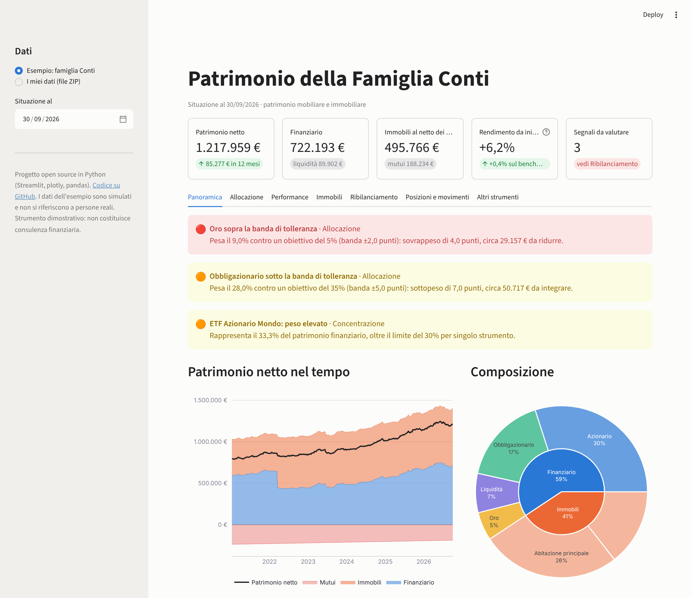
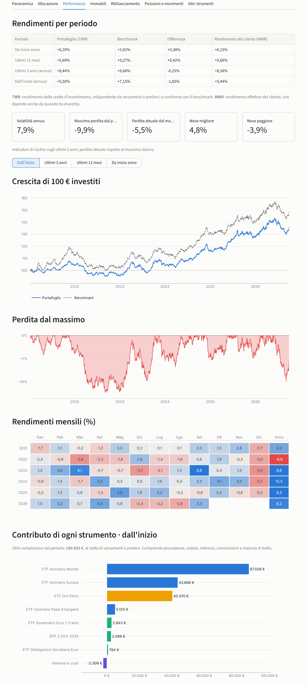
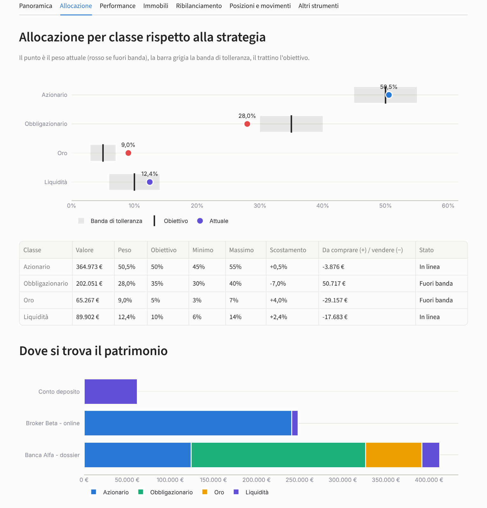
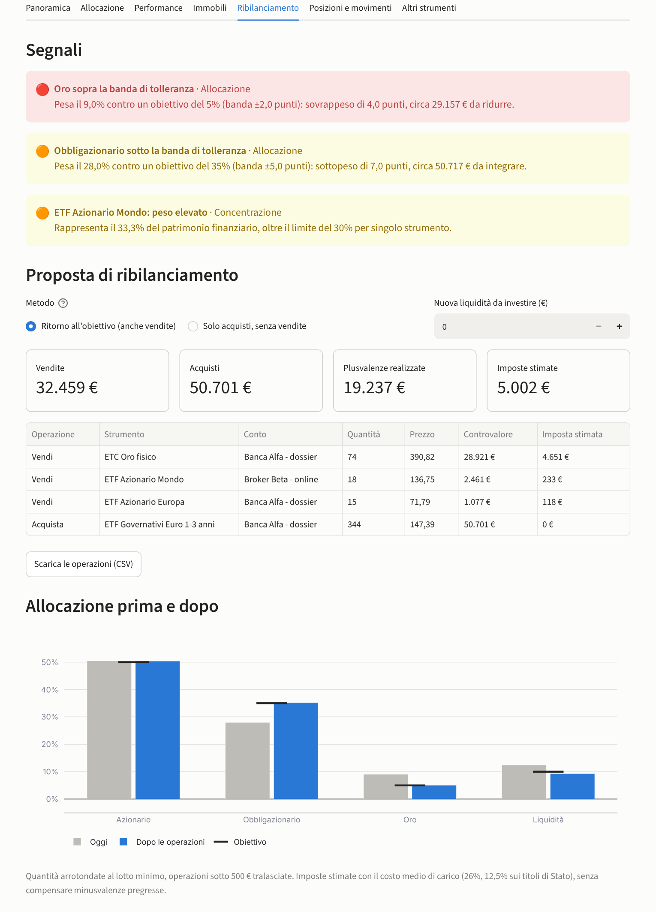
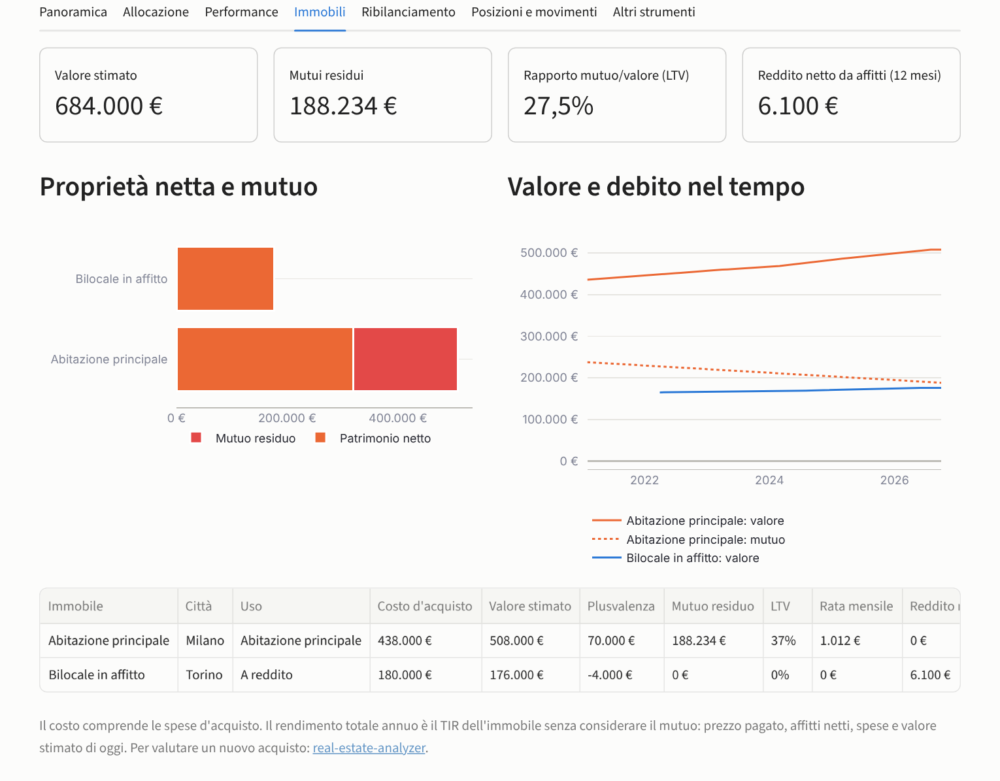

# Wealth Dashboard

**Dashboard di monitoraggio del patrimonio mobiliare e immobiliare, in Python con Streamlit.**

Raccoglie in un'unica vista conti titoli, liquidità, immobili e mutui di un cliente e risponde alle domande di
ogni revisione periodica: **quanto vale oggi il patrimonio e com'è distribuito? Come sta andando rispetto al
benchmark? L'allocazione è ancora quella concordata? Serve ribilanciare, e quanto costerebbe in imposte?**

I dati sono sei file leggibili anche da chi non programma (CSV e TOML). Dalla dashboard si esportano gli input per
gli altri progetti della serie, così l'analisi prosegue negli strumenti dedicati.



## Cosa fa

| Area | Contenuto |
|---|---|
| **Posizioni** | Ricostruzione giorno per giorno di quantità e liquidità di ogni conto a partire dai movimenti; costo medio ponderato, plusvalenze latenti e realizzate, imposta latente per strumento |
| **Patrimonio netto** | Finanziario + immobili − mutui nel tempo; composizione per classe e per immobile; ripartizione per conto |
| **Performance** | Rendimento ponderato per il tempo (**TWR**) e per il denaro (**MWR**, XIRR) per periodo, confronto con un benchmark a pesi costanti, rendimenti mensili, perdita dal massimo, volatilità, contributo in euro di ogni strumento |
| **Immobili** | Valore interpolato tra le valutazioni, debito residuo del mutuo alla francese, LTV, reddito netto da affitti, rendimento netto e rendimento totale annuo (TIR) di ogni immobile |
| **Segnali** | Classi fuori dalla banda di tolleranza, riserva di liquidità sotto i mesi di spesa previsti, concentrazione su un singolo strumento, quota immobiliare eccessiva, LTV oltre il limite, perdita dal massimo oltre la soglia |
| **Ribilanciamento** | Operazioni proposte con due metodi (ritorno all'obiettivo, oppure solo acquisti con la liquidità in eccesso e i nuovi versamenti), arrotondate al lotto minimo, con plusvalenze realizzate e **imposte stimate** (26%, 12,5% sui titoli di Stato) e allocazione prima/dopo |
| **Integrazioni** | Esporta i prezzi per [portfolio-optimizer](https://github.com/Torraf-MI/portfolio-optimizer) e il file di ipotesi per [wealth-planner-montecarlo](https://github.com/Torraf-MI/wealth-planner-montecarlo) |

Calcoli in `pandas` e `numpy`, grafici interattivi `plotly`, interfaccia `Streamlit`. Il motore è separato
dall'interfaccia: le stesse funzioni si usano da Python, dalla riga di comando o dalla dashboard.

## Avvio rapido

```bash
git clone https://github.com/Torraf-MI/wealth-dashboard.git
cd wealth-dashboard
pip install -e .

wealth-dashboard          # apre la dashboard nel browser sull'esempio dimostrativo
```

In alternativa `streamlit run streamlit_app.py`. Il file `streamlit_app.py` e il `requirements.txt` permettono di
pubblicare la dashboard gratuitamente su [Streamlit Community Cloud](https://streamlit.io/cloud) collegando il
repository.

Dalla barra laterale si sceglie la data di valutazione (tutta la dashboard si ricalcola a quella data) e si
caricano i propri dati come archivio ZIP; il pulsante *Scarica il modello* fornisce i file dell'esempio da usare
come traccia.

### Riga di comando

```bash
# Segnali e operazioni proposte, senza aprire il browser (utile per un controllo periodico automatico)
wealth-dashboard segnali
wealth-dashboard segnali --dati cartella_cliente --metodo solo_acquisti --liquidita 10000

# Ipotesi per la pianificazione Monte Carlo con patrimonio e allocazione di oggi
wealth-dashboard planner --eta 52 --versamento 18000 --pensione 30000 --output piano.toml
wealth-planner --config piano.toml
```

```
Famiglia Conti: patrimonio netto 1.217.959 € (finanziario 722.193 €, immobili 684.000 €, mutui 188.234 €)

[ALTO ] Oro sopra la banda di tolleranza
        Pesa il 9,0% contro un obiettivo del 5% (banda ±2,0 punti): sovrappeso di 4,0 punti, circa 29.157 € da ridurre.
[MEDIO] Obbligazionario sotto la banda di tolleranza
        Pesa il 28,0% contro un obiettivo del 35% (banda ±5,0 punti): sottopeso di 7,0 punti, circa 50.717 € da integrare.
[MEDIO] ETF Azionario Mondo: peso elevato
        Rappresenta il 33,3% del patrimonio finanziario, oltre il limite del 30% per singolo strumento.

Operazioni proposte (metodo: obiettivo)
  Vendi            74 ETC Oro fisico                         28.921 €   imposta stimata 4.651 €
  Vendi            18 ETF Azionario Mondo                     2.461 €   imposta stimata 233 €
  Vendi            15 ETF Azionario Europa                    1.077 €   imposta stimata 118 €
  Acquista        344 ETF Governativi Euro 1-3 anni          50.701 €   imposta stimata 0 €
```

### Uso come libreria

```python
from wealth_dashboard import esempio, operazioni, segnali
from wealth_dashboard import allocazione, immobili, performance

p = esempio()                                   # oppure carica("cartella") / carica_zip(bytes)
print(allocazione.sintesi(p))                   # patrimonio netto, finanziario, immobili, mutui, liquidità
print(allocazione.per_classe(p))                # pesi, obiettivi, bande, importi da riallineare
print(performance.periodi(p))                   # TWR, benchmark, MWR per periodo
print(performance.contributi(p))                # utile in euro per strumento
print(immobili.riepilogo(p))                    # valore, mutuo, LTV, redditività di ogni immobile
for s in segnali(p):
    print(s.livello, s.titolo)
print(operazioni(p, metodo="solo_acquisti", nuova_liquidita=20_000))
```

## I dati

| File | Contenuto |
|---|---|
| `strumenti.csv` | codice, nome, classe di attività, aliquota sulle plusvalenze, fattore di prezzo (0,01 per le obbligazioni quotate a 100), lotto minimo |
| `prezzi.csv` | una colonna data e una colonna di prezzi per strumento: lo stesso formato di portfolio-optimizer |
| `movimenti.csv` | data, conto, tipo, strumento, quantità, prezzo, costi, importo |
| `immobili.csv` | data e prezzo d'acquisto, costi accessori, mutuo (importo, tasso, durata, inizio) |
| `valutazioni_immobili.csv` | valutazioni periodiche (perizie, stime, quotazioni OMI) |
| `strategia.toml` | allocazione obiettivo con bande, spesa mensile e mesi di riserva, limiti, strumenti preferiti, benchmark |

I tipi di movimento sono `VERSAMENTO`, `PRELIEVO`, `ACQUISTO`, `VENDITA`, `CEDOLA`, `DIVIDENDO`, `INTERESSI`,
`COSTO` (bollo, commissioni), `AFFITTO` e `SPESA_IMMOBILE` (riferiti a un immobile nella colonna strumento).
Per acquisti e vendite l'importo si può lasciare vuoto: è calcolato da quantità, prezzo, fattore e costi.

La strategia si scrive così:

```toml
cliente = "Famiglia Conti"
spesa_mensile = 4500
mesi_liquidita_minima = 6

[obiettivo]                                   # pesi sul patrimonio finanziario e bande di tolleranza
Azionario = { peso = 0.50, banda = 0.05 }
Obbligazionario = { peso = 0.35, banda = 0.05 }
Oro = { peso = 0.05, banda = 0.02 }
"Liquidità" = { peso = 0.10, banda = 0.04 }

[limiti]
peso_massimo_strumento = 0.30
quota_immobiliare_massima = 0.60
ltv_massimo = 0.50
drawdown_allerta = 0.10

[strumenti_preferiti]                         # dove investire i nuovi acquisti di ogni classe
Obbligazionario = "OBB_GOV_BREVE"

[benchmark]
AZ_MONDO = 0.50
OBB_CORP = 0.20
OBB_GOV_BREVE = 0.15
ORO = 0.05
"Liquidità" = 0.10
```

## L'esempio dimostrativo

La famiglia Conti ha due dossier titoli (una banca e un broker online con un piano di accumulo mensile), un conto
deposito, l'abitazione principale a Milano con mutuo e un bilocale a Torino acquistato nel 2022 con la liquidità
del dossier e dato in affitto. I prezzi sono simulati e somigliano solo a grandi linee al 2021-2026 (ribasso di
azioni e obbligazioni nel 2022, forte rialzo dell'oro); lo script `scripts/genera_esempio.py` li rigenera.

Situazione al 30/09/2026: patrimonio netto di 1,22 milioni, di cui 722.000 € finanziari e 496.000 € di immobili
al netto del mutuo.

| Periodo | Portafoglio (TWR) | Benchmark | Rendimento del cliente (MWR) |
|---|---|---|---|
| Da inizio anno | +6,2% | +5,8% | +6,2% |
| Ultimi 12 mesi | +5,7% | +5,3% | +5,7% |
| Ultimi 3 anni (annuo) | +8,4% | +8,7% | +8,4% |
| Dall'inizio (annuo) | +5,5% | +7,2% | +5,4% |



Il rialzo dell'oro ha portato la classe al 9% contro un obiettivo del 5%, mentre le obbligazioni sono scese al 28%.
Il ritorno all'obiettivo richiede circa 32.000 € di vendite e costa **circa 5.000 € di imposte** sulle plusvalenze
realizzate; il metodo *solo acquisti* usa la liquidità in eccesso per comprare obbligazioni, non vende nulla e non
paga imposte, ma lascia l'oro sopra la banda finché nuovi versamenti non ne diluiscono il peso. La scelta tra i due
è proprio il tipo di decisione che la dashboard rende esplicita.







## Metodologia in breve

- **Posizioni**: i movimenti sono allineati al primo giorno di borsa utile e cumulati; il valore di ogni giorno è
  quantità × prezzo × fattore più la liquidità dei conti. Il costo di carico segue il metodo del costo medio
  ponderato: gli acquisti (commissioni comprese) lo aumentano, le vendite lo riducono in proporzione.
- **TWR**: `r_t = (V_t − F_t) / V_(t−1) − 1`, con `F_t` i flussi esterni del giorno (versamenti, prelievi, affitti
  incassati, spese degli immobili) considerati a fine giornata; i rendimenti giornalieri sono concatenati. Cedole,
  interessi, commissioni e bollo restano dentro il rendimento.
- **MWR**: XIRR dei flussi esterni con il valore iniziale e finale del periodo, giorni effettivi / 365, risolto per
  bisezione.
- **Benchmark**: pesi costanti sugli strumenti indicati, ribilanciati ogni giorno; la liquidità rende zero.
- **Contributi**: per ogni strumento, variazione di valore più incassi netti nel periodo (vendite, cedole, dividendi
  meno acquisti). La somma è l'utile complessivo al netto di versamenti e prelievi.
- **Immobili**: valore interpolato linearmente tra le valutazioni e costante dopo l'ultima; mutuo alla francese con
  rata mensile costante, la prima un mese dopo l'erogazione. Il rendimento totale annuo è il TIR di prezzo e costi
  d'acquisto, affitti netti, spese e valore attuale, senza leva.
- **Ribilanciamento**: gli importi per classe sono ripartiti tra gli strumenti già posseduti in proporzione al
  valore (o sullo strumento preferito per gli acquisti) e arrotondati per difetto al lotto minimo. L'imposta stimata
  è l'aliquota dello strumento sulla plusvalenza calcolata con il costo medio di carico del conto.

## Parte di una serie

| Progetto | Domanda a cui risponde |
|---|---|
| [portfolio-optimizer](https://github.com/Torraf-MI/portfolio-optimizer) | Qual è l'allocazione efficiente? (Markowitz, risk parity, backtest) |
| [real-estate-analyzer](https://github.com/Torraf-MI/real-estate-analyzer) | Conviene questo investimento immobiliare? (flussi, mutuo, fiscalità, TIR) |
| [wealth-planner-montecarlo](https://github.com/Torraf-MI/wealth-planner-montecarlo) | Il patrimonio basta per gli obiettivi e la pensione? (Monte Carlo) |
| **wealth-dashboard** | Com'è il patrimonio oggi e cosa va fatto? (monitoraggio e ribilanciamento) |

## Struttura

```
src/wealth_dashboard/
├── dati.py             # lettura e validazione dei sei file (cartella o ZIP), strategia
├── posizioni.py        # quantità, liquidità, costo medio, plusvalenze, fotografia a una data
├── performance.py      # TWR, MWR (XIRR), benchmark, rischio, rendimenti mensili, contributi
├── immobili.py         # valori interpolati, mutuo alla francese, redditività
├── allocazione.py      # pesi per classe e conto, patrimonio netto nel tempo
├── ribilanciamento.py  # segnali e operazioni proposte con stima delle imposte
├── integrazioni.py     # esportazioni per gli altri progetti della serie
├── grafici.py          # grafici plotly
├── app.py              # dashboard Streamlit
├── cli.py              # riga di comando
└── esempio/            # dati dimostrativi della famiglia Conti
scripts/genera_esempio.py
tests/                  # 25 test (pytest), eseguiti a ogni push con GitHub Actions
```

## Test

```bash
pip install -e ".[dev]"
pytest
```

I test verificano su casi calcolati a mano il costo medio e le plusvalenze realizzate, la liquidità dopo acquisti
e vendite, il fattore delle obbligazioni, il TWR (uguale al rendimento di prezzo e indipendente da un grosso
versamento fatto prima di un calo, che invece rende negativo l'MWR), l'XIRR, che i contributi sommino all'utile,
il debito residuo del mutuo rata per rata, l'interpolazione delle valutazioni, che il ribilanciamento riporti i
pesi all'obiettivo e che il metodo solo acquisti non venda e non generi imposte; che il file esportato sia letto
da wealth-planner-montecarlo e che la dashboard si avvii e si aggiorni senza errori (`streamlit.testing`).

## Avvertenze

I dati dell'esempio sono simulati e **non si riferiscono a persone reali**. La fiscalità è semplificata: aliquota
per strumento sulla plusvalenza calcolata con il costo medio, senza compensazione delle minusvalenze, senza
distinzione tra redditi di capitale e redditi diversi e senza la quota di titoli di Stato nei fondi. Il progetto ha
scopo dimostrativo e non costituisce consulenza finanziaria, fiscale o immobiliare.

## Licenza

MIT. Autore: Francesco Torraco.
